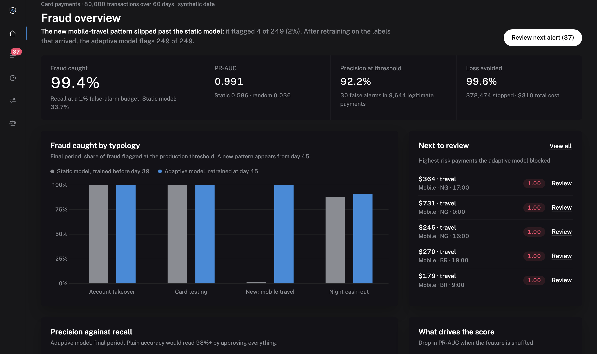

# FraudShield — DataNova 2026, DN-FN-01 Real-Time Payment Fraud Detection

Real-time fraud scoring with low false positives, drift adaptation and cost-aware decisions.

**Live demo:** https://fraudshield-beta-livid.vercel.app · **Slides:** [docs/FraudShield-DN-FN-01.pptx](docs/FraudShield-DN-FN-01.pptx) · Built solo by KingDavid.



## Results (final, unseen period)
| | Static model | FraudShield (adaptive) |
|---|---|---|
| Fraud caught (recall) | 30.1% | **99.2%** |
| Precision | 79.3% | **92.2%** |
| False alarms | 28 of 9,644 | 30 of 9,644 (0.31%) |
| Recall on the new mobile-travel pattern | 1.6% | **100%** |
| Total cost (missed fraud + $5/review) | $45,186 | **$310** |

## Run
```bash
python -m venv .venv && source .venv/bin/activate
pip install -r requirements.txt
python train.py     # generates data, trains, validates, writes artifacts/
python app.py       # dashboard at http://localhost:5050
```

## What you can do in the dashboard
- **Overview:** headline finding, KPIs, recall by fraud typology (static vs adaptive), PR curve, feature importance.
- **Alert queue:** every flagged payment, filterable (needs review, all, missed by static model, reviewed). Open one to see why it was flagged and record a verdict (confirm fraud / mark legitimate); verdicts persist in `artifacts/reviews.json` and the queue advances to the next alert.
- **Score a payment:** enter any payment (or load a preset case) and get approve / review / block with a per-feature explanation. Inputs are validated server-side with errors shown next to each field.
- **Threshold and cost:** move the block threshold and watch fraud stopped, false alarms and total cost update.
- **Fairness:** false-positive rate and recall by channel and home country.

Every view has its own URL (`#queue`, `#score`, …) and the back button works.

## API
`GET /api/metrics` · `GET /api/stream` · `GET /api/explain/<txn_id>` · `POST /api/review/<txn_id>` `{verdict: "fraud"|"legit"|null}` · `POST /api/score`

## Approach
- **Data:** synthetic 80k-transaction / 60-day portfolio, 1.6% fraud, four typologies (account takeover, card testing, night cash-out, and a *new* mobile-travel pattern that only appears in the last quarter). Synthetic by necessity — no real payment data was available, so absolute scores overstate real-world separability.
- **Features (causal only):** per-card velocity (1h/24h), amount vs. card's running average, geo mismatch, device, merchant risk, hour, account age.
- **Model:** class-balanced HistGradientBoosting blended (max) with an unsupervised IsolationForest for novel behaviour.
- **Validation:** strictly time-ordered split — train 0–65%, validation 65–75% (threshold chosen to minimise *missed fraud $ + $5/review*), test A 75–87.5%, test B 87.5–100%.
- **Drift:** static model (trained on early data) vs. adaptive model (retrained once test-A labels arrive). Static recall on the new pattern ≈ 0–1%; adaptive ≈ 100%.
- **Explainability:** per-transaction occlusion attribution on the log-odds scale; permutation importance globally.
- **Responsible AI:** FPR/recall by channel and home country, no protected attributes, borderline scores routed to human review.

## Caveats
Single synthetic dataset, one random seed; the drift scenario is constructed, so the adaptive model's near-perfect recall on it should be read as a demonstration of the retraining loop, not a benchmark.

## Deploy
Deployed on Vercel as a Python (Flask) function: `vercel deploy --prod`. The trained model in `artifacts/` is committed, so nothing trains at build time. On Vercel, reviewer verdicts are kept in `/tmp` and reset when the function restarts.
